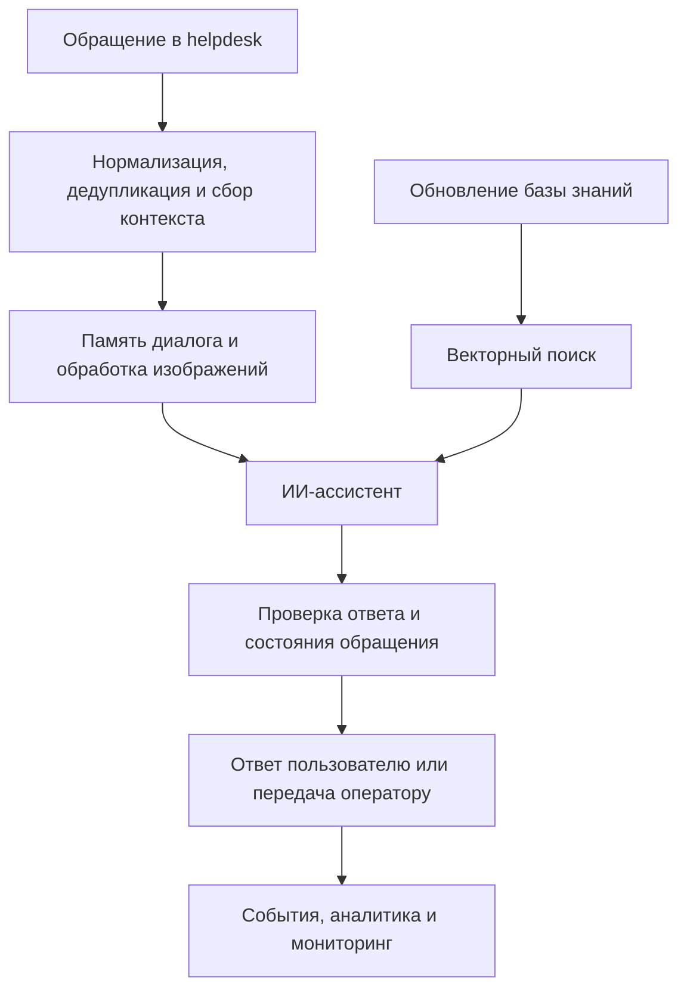

# Project 1 · ИИ-система для автоматизации поддержки

Разработка и сопровождение системы первой линии поддержки: от приёма обращения
и поиска информации до ответа пользователю, передачи оператору и анализа
качества работы. Проект охватывал AI-логику, интеграции, хранение состояния,
инфраструктуру и эксплуатацию.

## Задача

Автоматизировать типовые обращения, сохранив контекст разговора и возможность
подключить человека. Система должна была работать с текстом и изображениями,
использовать актуальную базу знаний и корректно реагировать на повторные события,
ошибки внешних API и смену ответственного за обращение.

## Область работы

### ИИ-ассистент и управление диалогом

- Разработка сценариев обработки обращений и их оркестрация в n8n.
- Интеграция LLM, настройка системных инструкций, памяти и контекста диалога.
- Обработка изображений и объединение вложений с текстом обращения.
- Определение случаев, где требуется уточнение, ответ по базе знаний или оператор.
- Разделение генерации текста и действий в helpdesk: обещание передачи человеку
  должно соответствовать фактическому изменению состояния обращения.

### База знаний и RAG

- Интеграция источника внутренних материалов и обновление поискового индекса.
- Разбиение документов на смысловые фрагменты, подготовка embeddings и метаданных.
- Векторный поиск в Qdrant и включение релевантных материалов в контекст ответа.
- Работа над качеством поиска: структура документов, фильтрация и оценка retrieval.

### Интеграции и надёжность

- Приём и нормализация событий helpdesk, отправка ответов и синхронизация статусов.
- Перенос контура между платформами поддержки с сохранением основных сценариев.
- Дедупликация событий, объединение последовательных сообщений и хранение
  состояния между выполнениями workflow в PostgreSQL.
- Контроль передачи обращения оператору и проверки состояния перед ответом.
- Обработка ограничений внешних API, повторные попытки и резервные сценарии.

### Данные, аналитика и инфраструктура

- Формирование слоя событий и SQL-проекций для аналитики обращений.
- Дашборды по работе бота, эскалациям, времени ответа и активности поддержки.
- Развёртывание и сопровождение контейнерного стека на Linux с обратным прокси.
- Мониторинг инфраструктуры и workflow через Prometheus, Grafana и exporters.
- Документирование обновлений, диагностики, восстановления и отката изменений.

### Оценка качества ИИ

- Подготовка воспроизводимых сравнений моделей и вариантов обработки обращения.
- Анализ ошибок ответа, качества поиска, стоимости и причин передачи оператору.
- Регрессионные проверки для проблем, обнаруженных в диалогах и эксплуатации.
- Разработка архитектуры, в которой критические решения проверяются программно,
  а модель отвечает за ограниченную часть сценария.

## Общая схема решения

Схема показывает функциональные этапы без раскрытия внутренней топологии,
конфигурации доступа и конкретных правил обработки обращений.

## Результат

Создан и введён в эксплуатацию AI-конвейер поддержки с поиском по базе знаний,
памятью диалога, обработкой изображений и передачей сложных случаев человеку.
Команда получила данные и дашборды для анализа работы автоматизации.

Отдельным результатом стал контур оценки качества: варианты моделей и сценариев
можно было сравнивать до изменения пользовательского потока. Улучшения,
проверенные в offline-оценке или локальных тестах, не приравниваются к результатам
в production. Частные метрики, выборки и детали эксплуатации здесь не раскрываются.

## Технологии

n8n, JavaScript, LLM API, RAG, Vision, PostgreSQL, Qdrant, SQL, Docker,
Linux, reverse proxy, Prometheus, Grafana.

## Публичные материалы

В этой папке размещены обезличенные фрагменты подготовки данных для RAG:
чанкование, восстановление метаданных после embedding, группировка документов
и формирование векторных точек со стабильными ID. Есть синтетический пример
и тесты поведения этих модулей.

Это выбранная часть более крупной системы. Рабочие workflow, документы базы
знаний, промпты, реальные обращения, адреса сервисов и credentials исключены.
Демонстрационные векторы вымышлены и не являются семантическими embeddings.
