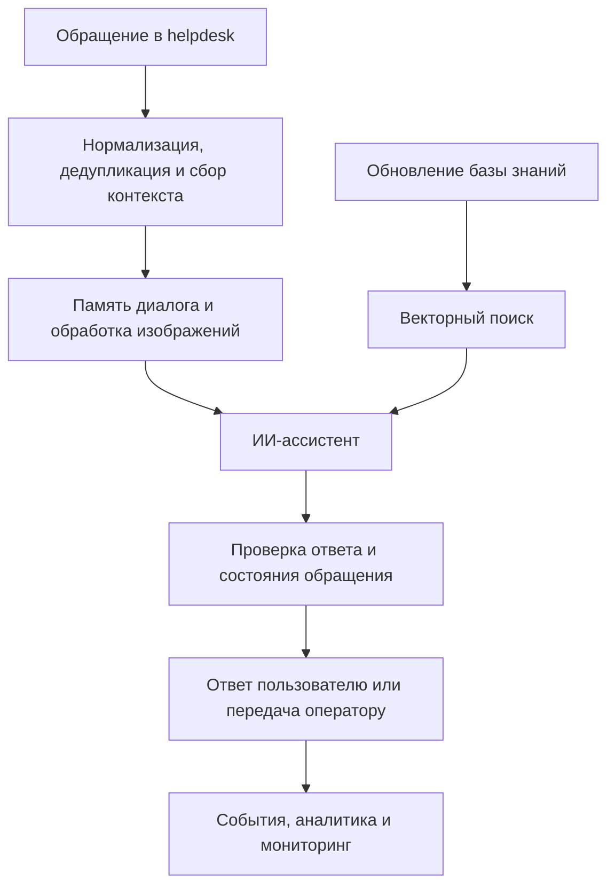

# Project 1 · ИИ-система для автоматизации поддержки

ИИ-система первой линии поддержки, которая принимает обращения, ищет информацию,
отвечает пользователю и передаёт сложные случаи оператору. Работа над проектом
включала логику ассистента, интеграции, хранение состояния диалогов, инфраструктуру
и сопровождение системы.

## Задача

Автоматизировать типовые обращения, сохранив контекст разговора и возможность
подключить человека. Система должна была работать с текстом и изображениями,
использовать актуальную базу знаний и учитывать повторные события, ошибки внешних
API и смену ответственного за обращение.

## Что сделано

### ИИ-ассистент и диалоги

Сценарии обработки обращений построены в n8n. К LLM подключены системные
инструкции и память диалога; изображения обрабатываются вместе с текстом обращения.
В сценариях предусмотрены ответы по базе знаний, уточняющие вопросы и передача
оператору.

Генерация текста отделена от действий в helpdesk. Если ассистент обещает передать
обращение человеку, это должно сопровождаться изменением состояния обращения.

### База знаний и RAG

Подключён источник внутренних материалов. Поисковый индекс обновляется.
Документы разбиваются на смысловые фрагменты, для которых готовятся embeddings
и метаданные. Qdrant находит подходящие материалы, и они попадают в контекст ответа.

Работа над качеством поиска включала структуру документов, фильтрацию и оценку
retrieval.

### Интеграции и надёжность

Система принимает события helpdesk, приводит их к общему формату, отправляет
ответы и синхронизирует статусы. При переносе между платформами поддержки
сохранены основные сценарии.

Повторные события отсеиваются, последовательные сообщения объединяются,
а состояние между выполнениями workflow хранится в PostgreSQL. Перед ответом
проверяется состояние обращения; передача оператору контролируется отдельно.
Для ограничений внешних API предусмотрены повторные попытки и резервные сценарии.

### Аналитика и инфраструктура

События обращений и SQL-проекции используются для аналитики. Дашборды показывают
работу бота, эскалации, время ответа и активность поддержки.

Контейнерный стек развёрнут на Linux с обратным прокси. За инфраструктурой
и workflow следят Prometheus, Grafana и exporters. Описаны процедуры обновления,
диагностики, восстановления и отката изменений.

### Качество ИИ

Подготовлены воспроизводимые сравнения моделей и вариантов обработки обращений.
Оценка охватывает ошибки ответов, качество поиска, стоимость и причины передачи
оператору. Проблемы, найденные в диалогах и при эксплуатации, включены
в регрессионные проверки.

Отдельное направление работы: архитектура, в которой критические решения
проверяются программно, а модель отвечает за ограниченную часть сценария.

### Chatwoot и защита серверов

Chatwoot рассматривался как альтернативная платформа поддержки. Для оценки
развёрнут отдельный тестовый стенд без рабочих данных. Проверены возможности
платформы по каналам связи, ролям, SLA, аналитике, истории обращений и миграции.
В разборе требований отмечено, что доступно штатно, что требует Enterprise,
а для чего нужны собственный backend и адаптеры.

На стенде проведён аудит безопасности и выполнен харденинг сервера: настроены
SSH-доступ по ключам, ограничения входа, защита от перебора, журналирование
и обновления безопасности. Для контейнеров ограничены привилегии и запись
в файловую систему, закреплены версии образов и настроены сетевые правила.
Изменения вносились поэтапно с проверкой доступности приложения и подключения к БД.

Подготовлены инструкции по сопровождению, план резервного копирования
и восстановления, критерии готовности к production. Стенд доведён до технического
пилота. Для перехода в production требовались внешние резервные копии с проверкой
восстановления, мониторинг и алерты, отказоустойчивость и дополнительные интеграции.
Миграция в production не выполнялась.

## Как устроена система

Схема показывает этапы обработки. Внутренняя топология, настройки доступа
и конкретные правила обработки обращений не раскрываются.

## Результат

Система введена в эксплуатацию: в ней работают поиск по базе знаний, память
диалога, обработка изображений и передача сложных случаев человеку.
У команды есть данные и дашборды для анализа автоматизации.

Для Chatwoot подготовлен отдельный пилотный стенд с настроенной защитой сервера
и контейнеров. Оценка требований показала, что нужно доработать до рабочего внедрения.

Модели и сценарии можно было сравнивать до изменения пользовательского потока.
Результаты offline-оценки и локальных тестов не означают, что те же улучшения
достигнуты в production. Частные метрики, выборки и детали эксплуатации
здесь не раскрываются.

## Технологии

n8n, JavaScript, LLM API, RAG, Vision, PostgreSQL, Qdrant, SQL, Docker,
Linux, reverse proxy, Prometheus, Grafana, Chatwoot, Redis.

## Что опубликовано

В папке собраны обезличенные модули подготовки данных для RAG: чанкование,
восстановление метаданных после embedding, группировка документов и формирование
векторных точек со стабильными ID. Для них есть пример с вымышленными данными
и тесты поведения.

Это часть исходной системы. Рабочие workflow, документы базы знаний, промпты,
реальные обращения, адреса сервисов и credentials исключены. Векторы в примере
вымышлены и не являются семантическими embeddings.
