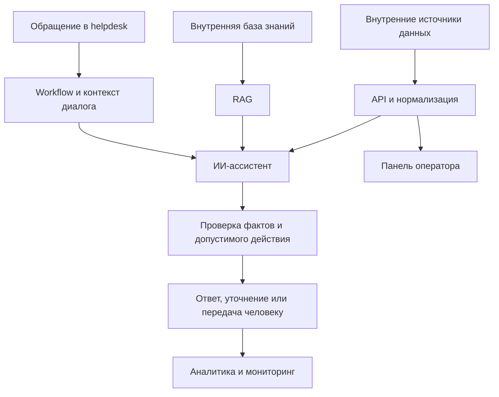

# Project 2 · ИИ-поддержка и инструменты для операторов

Развитие автоматизации поддержки вокруг ИИ-ассистента, внутренних данных
и рабочего интерфейса оператора. Проект объединял диалоговую логику, RAG,
API-интеграции, backend, панель поддержки и мониторинг.

## Задача

Сократить ручную обработку типовых обращений и дать оператору единый контекст
для сложных случаев. Ответы ассистента должны были опираться на базу знаний
и проверенные данные, а действия в helpdesk — соответствовать реальному
состоянию диалога и полномочиям системы.

## Область работы

### ИИ-ассистент поддержки

- Построение событийного workflow: обращение из helpdesk, сбор контекста,
  генерация ответа, проверка и изменение состояния диалога.
- Интеграция LLM, памяти разговора и суммаризации предыдущей переписки.
- Обработка скриншотов и нескольких изображений в одном обращении.
- Поиск по внутренним статьям через RAG и регулярное обновление индекса.
- Классификация обращений, разметка, ожидание уточнений и передача оператору.
- Обработка повторных обращений и ограничение ответов рамками назначенных ИИ диалогов.

### Внутренние данные и API

- Подключение внутренних источников для получения контекста учётной записи
  и событий продукта.
- Нормализация неоднородных API-ответов в единый формат для ассистента и интерфейса.
- Формирование набора проверенных фактов, отделённого от утверждений пользователя
  и предыдущих ответов модели.
- Разработка backend-слоя для работы панели с внутренними сервисами.
- Обработка неполных данных и ошибок источников без подмены неизвестного
  предположениями модели.

### Панель оператора

- Разработка интерфейса поиска и карточки с объединёнными данными из API.
- Представление состояний загрузки, отсутствующих данных и ошибок источников.
- Реализация входа операторов, сессий, управления доступом и журнала действий.
- Выделение общих правил нормализации и проверок на backend, чтобы интерфейс
  и автоматизация работали с согласованными данными.
- Тестирование API, обработки данных и компонентов интерфейса.

### Контроль поведения и безопасность

- Программные проверки после генерации ответа и перед действиями в helpdesk.
- Разделение информационного ответа, запроса уточнения и передачи человеку.
- Проверки неподтверждённых утверждений и обещаний выполненных действий.
- Управление тем, какие сведения нужны в контексте конкретного обращения.
- Валидация входных данных, безопасное хранение паролей операторов и защита
  HTTP-слоя панели.

### Инфраструктура и эксплуатация

- Развёртывание контейнерного стека для автоматизации, хранения данных,
  векторного поиска и операторского инструмента.
- Настройка обратного прокси, TLS и ограничений доступа к внутренним сервисам.
- Мониторинг через Prometheus и Grafana, подготовка SQL-представлений и дашбордов.
- Диагностика сбоев, развитие защитных проверок и регрессий по результатам эксплуатации.

## Общая схема решения

Схема описывает взаимодействие функциональных частей без внутренних адресов,
схем клиентских данных и конкретных бизнес-правил.

## Результат

Реализован AI-контур обработки обращений с контекстом, базой знаний и интеграцией
в helpdesk. Разработана панель поддержки с backend-слоем для работы с внутренними
данными. Автоматизация и операторский инструмент получили согласованное
представление фактов и явные сценарии обработки ошибок.

Защитные проверки дополнили системные инструкции модели: ограничения ответа
и действия контролируются также программно. Инфраструктура и мониторинг
поддерживают диагностику и сопровождение решения. Частные финансовые показатели,
параметры инфраструктуры и правила обслуживания в публичном кейсе не раскрываются.

## Технологии

n8n, JavaScript, TypeScript, Node.js, Fastify, React, Vite, LLM API,
RAG, Vision, PostgreSQL, Qdrant, SQL, Docker, Linux, Prometheus, Grafana.

## Публичные материалы

Для публикации выделены независимые модули API:

- `email.ts` — нормализация email и проверка символов, опасных в сегменте пути.
- `validate.ts` — проверка тела запроса, строковых полей и UUID.
- `password.ts` — scrypt, случайная соль и сравнение хеша через `timingSafeEqual`.
- `toolkit.test.mjs` — проверки граничных случаев на вымышленных данных.

Эти модули показывают часть backend-работы. Полный ассистент, панель оператора,
клиентские записи, правила обработки обращений, промпты и production-конфигурация
не входят в публичную версию.
