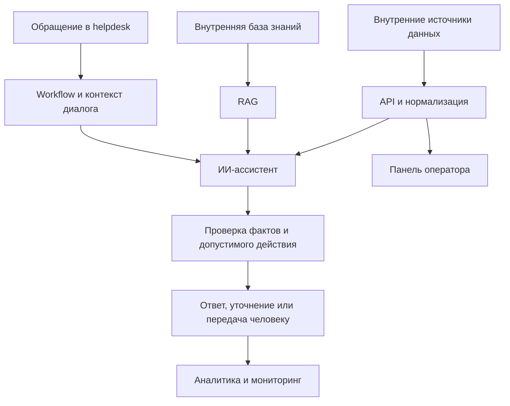

# Project 2 · ИИ-поддержка и инструменты для операторов

Проект объединяет ИИ-ассистента, внутренние данные и рабочий интерфейс оператора.
Работа включала диалоговую логику, RAG, API-интеграции, backend, панель поддержки
и мониторинг.

## Задача

Сократить ручную обработку типовых обращений и дать оператору контекст для сложных
случаев в одном месте. Ассистент должен был отвечать по базе знаний и проверенным
данным. Действия в helpdesk должны были соответствовать состоянию диалога
и полномочиям системы.

## Что сделано

### ИИ-ассистент поддержки

Обработка построена на событиях helpdesk: workflow собирает контекст, получает
ответ модели, проверяет его и меняет состояние диалога. Подключены LLM, память
разговора и суммаризация предыдущей переписки. Ассистент обрабатывает скриншоты,
в том числе несколько изображений в одном обращении.

Для поиска по внутренним статьям используется RAG с регулярным обновлением
индекса. Сценарии включают классификацию и разметку обращений, ожидание уточнений
и передачу оператору. Повторные обращения обрабатываются; ИИ отвечает
только в назначенных ему диалогах.

### Внутренние данные и API

Подключены внутренние источники данных об учётной записи и событиях продукта.
Неоднородные ответы API приводятся к единому формату для ассистента и интерфейса.
Проверенные факты отделены от утверждений пользователя и предыдущих ответов модели.

Для панели разработан backend, который работает с внутренними сервисами.
При неполных данных или ошибках источников неизвестное не подменяется
предположениями модели.

### Панель оператора

Разработаны поиск и карточка с объединёнными данными из API. В интерфейсе
предусмотрены состояния загрузки, отсутствующие данные и ошибки источников.
Для операторов реализованы вход, сессии, управление доступом и журнал действий.

Общие правила нормализации и проверки вынесены на backend, чтобы интерфейс
и автоматизация использовали согласованные данные. Тестировались API,
обработка данных и компоненты интерфейса.

### Проверки поведения и безопасность

После генерации ответа и перед действиями в helpdesk выполняются программные
проверки. Информационный ответ, запрос уточнения и передача человеку разделены.
Проверяются неподтверждённые утверждения и обещания выполненных действий.
Для каждого обращения определяется, какие сведения нужны в контексте.

В backend панели входят валидация входных данных, безопасное хранение паролей
операторов и защита HTTP-слоя.

### Инфраструктура и сопровождение

Развёрнут контейнерный стек для автоматизации, хранения данных, векторного поиска
и операторского инструмента. Настроены обратный прокси, TLS и ограничения доступа
к внутренним сервисам.

Мониторинг построен на Prometheus и Grafana; подготовлены SQL-представления
и дашборды. Работа над системой включала диагностику сбоев, защитные проверки
и регрессионные тесты по результатам эксплуатации.

## Как устроена система

Схема показывает, как связаны части системы. Внутренние адреса, схемы клиентских
данных и конкретные бизнес-правила не раскрываются.

## Результат

Реализован ИИ-ассистент, который работает с контекстом обращения, базой знаний
и helpdesk. Разработана панель поддержки с backend для внутренних данных.
Автоматизация и операторский инструмент используют согласованное представление
фактов; для ошибок предусмотрены явные сценарии обработки.

Ограничения ответов и действий проверяются программно в дополнение к системным
инструкциям модели. Инфраструктура и мониторинг помогают диагностировать сбои
и сопровождать решение. Частные финансовые показатели, параметры инфраструктуры
и правила обслуживания в публичном кейсе не раскрываются.

## Технологии

n8n, JavaScript, TypeScript, Node.js, Fastify, React, Vite, LLM API,
RAG, Vision, PostgreSQL, Qdrant, SQL, Docker, Linux, Prometheus, Grafana.

## Что опубликовано

В папке собраны независимые модули API:

- `email.ts`: нормализация email и проверка символов, опасных в сегменте пути.
- `validate.ts`: проверка тела запроса, строковых полей и UUID.
- `password.ts`: scrypt, случайная соль и сравнение хеша через `timingSafeEqual`.
- `toolkit.test.mjs`: проверки граничных случаев на вымышленных данных.

Модули показывают часть работы над backend. Полный ассистент, панель оператора,
клиентские записи, правила обработки обращений, промпты и production-конфигурация
не входят в публичную версию.
