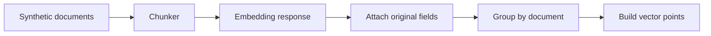

# RAG pipeline · n8n Code nodes

Подготовка документов для векторного хранилища без публикации рабочей базы знаний
или экспортов n8n. Код разбивает Markdown по заголовкам, режет длинные секции с
перекрытием и формирует точки с воспроизводимыми ID.



```sh
npm run demo:rag
node --test projects/rag-pipeline/pipeline.test.mjs
```

`demo.cjs` выполняет Code nodes локально с минимальной имитацией контекста n8n.
Демонстрация добавляет нейтральные метаданные между шагами и вымышленные векторы
вместо обращения к embedding API. Сетевых запросов и credentials нет.

`chunker.js`, `attach-embedding.js` и `aggregate.js` предназначены для режима
Run Once For All Items; `build-points.js` — для Run Once For Each Item.
Последнему нужен разрешённый встроенный модуль `crypto` в окружении n8n.
Это подготовка payload, а не готовый workflow: запись в хранилище, повторные
попытки и удаление устаревших чанков не выполняются.
